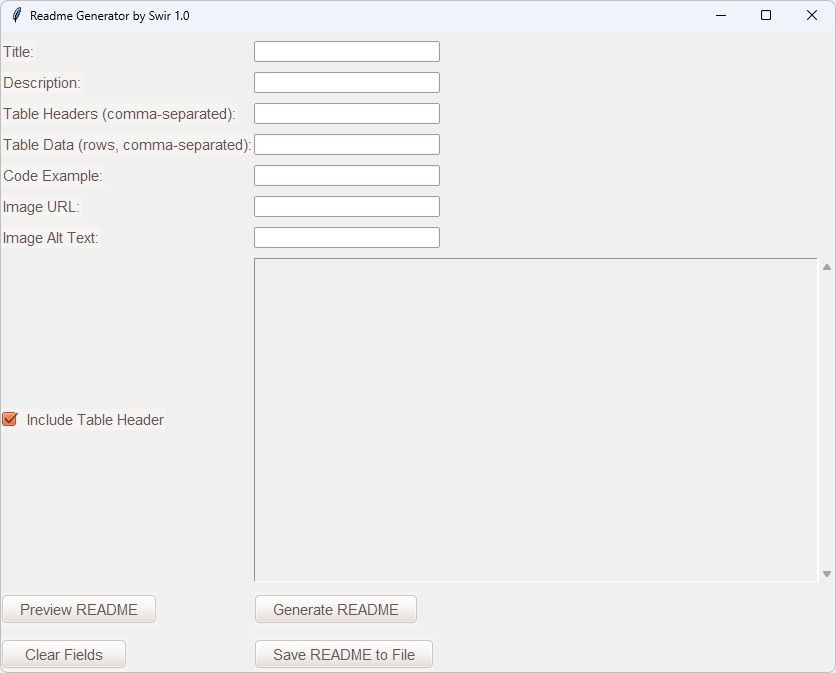

<!-- SWIR-README-STANDARD:v2 -->

<div align="center">


<br>


[](https://github.com/Swir)
[](https://github.com/Swir/Github-README-Generator/stargazers)

</div>

## 📸 Screenshot — earlier interface



Initial README generator window on Windows.

GitHub README Generator is a lightweight desktop utility for composing simple Markdown README files without manually typing every Markdown structure.

## 📍 Project Status


**Product progress:** **N/A** — this legacy utility has no authoritative, measurable product roadmap. The published release is not treated as a completion percentage.

| Item | Status |
|---|---|
| Current stage | Released utility |
| Primary UI | Tkinter + `ttkthemes` |
| Verified release workflow runtime | Python 3.12 on Windows |
| Current source | 1.1.0 |
| Windows download | [Latest verified release](https://github.com/Swir/Github-README-Generator/releases/latest) |
| Product roadmap | Not present |

## 🚀 Overview

The application collects a project title, description, optional Markdown table, code example and image metadata, then generates a Markdown document that can be previewed in the GUI and saved as a `.md` file. The current implementation is intentionally small and direct; it is a README drafting utility rather than a full Markdown IDE.

## ✨ Highlights

| Feature | What it does |
|---|---|
| 🏷️ Project title and description | Creates the main heading and preserves description paragraphs |
| 📊 Table builder | Parses CSV headers and one row per line, including quoted commas and multiline cells |
| 🧾 Optional table header | Can hide header labels while retaining valid GitHub Markdown table structure |
| 💻 Code section | Preserves multiline code and indentation, with an optional language and safe backtick fences |
| 🖼️ Image block | Generates Markdown image syntax from a URL and alternative text |
| 👁️ Preview | Opens the generated Markdown in a read-only preview window |
| 💾 Save | Writes UTF-8 Markdown atomically; failed saves preserve the previous file |
| 🧹 Clear | Resets form fields and generated output |
| 🐧 Ubuntu theme | Uses the `ttkthemes` Ubuntu theme for the desktop interface |

## ⚙️ Quick Start

### Recommended Windows build

Download the [latest verified Windows release](https://github.com/Swir/Github-README-Generator/releases/latest). New releases contain the EXE, portable ZIP, `SHA256SUMS.txt`, source/build provenance and runtime verification results. See [CHANGELOG.md](CHANGELOG.md) for source version 1.1.0.

[**Open GitHub Releases →**](https://github.com/Swir/Github-README-Generator/releases)

### From source

```bash
git clone https://github.com/Swir/Github-README-Generator.git
cd Github-README-Generator
python -m pip install -r requirements.txt
python main.py
```

The release workflow runs regression tests, builds the Windows executable with PyInstaller, checks its hidden-window export flow and verifies a fresh draft-package download before publication. The source itself has no declared cross-platform CI matrix, so broader runtime support is not claimed here.

## 🎮 Usage

1. Enter a project title and optional description.
2. Add comma-separated headers and put each data row on its own line. Quote cells containing commas, for example `"Alice, Jr.",10`. Each row must match the number of columns.
3. Add a multiline code example and optional language. Image references accept HTTP(S) URLs or relative paths, plus alternative text.
4. Choose whether table header labels should be included. A blank structural header is retained when labels are hidden, as required by GitHub Markdown.
5. Use **Preview README** to inspect the generated Markdown.
6. Use **Generate README** to refresh the main output.
7. Use **Save README to File** to write the result to disk.

## 🧠 Implementation

| Layer | Technology / role |
|---|---|
| Desktop UI | Python `tkinter` / `ttk` |
| Theme | `ttkthemes` (`ubuntu`) |
| Markdown generation | `markdown_core.py`: CSV parsing, Markdown escaping and safe code fences |
| Preview | Tkinter `Toplevel` + read-only `ScrolledText` |
| Windows packaging | PyInstaller in the repository release workflow |

## 🗺️ Roadmap / Progress


**Measured scope:** product roadmap · **Progress:** N/A · **Counter:** N/A — no canonical checklist or weighted roadmap exists.

The SVG deliberately shows **N/A** instead of inventing a completion percentage from the v1.0.0 release, commit count or documentation state.

## 📦 Releases

Current source: **1.1.0**. Use the [latest verified public release](https://github.com/Swir/Github-README-Generator/releases/latest). Publication follows regression, frozen-runtime, checksum and fresh-download checks; existing public releases are never overwritten.

[**GitHub Releases →**](https://github.com/Swir/Github-README-Generator/releases)

## ⚠️ Limitations

- Tables use CSV input with up to 1,000 rows, 50 columns and 128 KiB of input. This is not a spreadsheet editor.
- Code-language highlighting is controlled by the optional language field; the local preview remains plain Markdown text.
- Image support inserts Markdown links; it does not upload or manage image files.
- The preview is plain text, not a rendered GitHub Markdown browser.
- No authoritative roadmap exists, so product completion is intentionally reported as N/A.

## 🧪 Verification

```powershell
python -m unittest discover -s tests -v
python main.py --self-test readme-self-test.json
```

The smoke test creates a hidden window, generates a quoted CSV table and multiline code, saves and reopens a temporary UTF-8 file, and checks invalid input. It does not open file dialogs or modify user documents.

## 🔎 Search Keywords

`github readme generator` • `markdown readme builder` • `python markdown gui` • `tkinter readme generator` • `desktop markdown tool` • `markdown table generator` • `github documentation utility` • `readme preview tool` • `python tkinter utility` • `windows readme generator` • `markdown image syntax` • `markdown code block generator`

<div align="center">


### `WRITE • PREVIEW • SAVE • DOCUMENT`

⭐ **If this utility is useful, consider leaving a star.**

[**← SWIR profile**](https://github.com/Swir) · [**All projects →**](https://github.com/Swir?tab=repositories)

</div>
